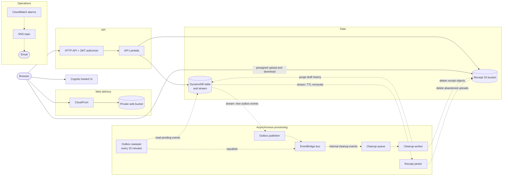

# ClaimFlow

[](https://github.com/Hollowpath/claimflow/actions/workflows/ci.yml)

ClaimFlow manages employee expense claims from submission to reimbursement. Employees record expenses and attach receipts, managers review and decide on the claims assigned to them, and finance administrators maintain category policy and mark approved claims as paid. Every accepted change is authorized on the server and recorded in a history whose entries are never edited. Deleting an eligible draft (one that was never submitted) deletes its history with it.

**Live site:** [ClaimFlow on AWS](https://d3vq4pyeoivioy.cloudfront.net) (serverless, `ap-southeast-1`). Sign-in uses Amazon Cognito, and accounts are created by an administrator, so the site is not open to self-registration. **Local demo mode** (`npm run dev`, below) runs the same application on your machine with selectable sample users and JSON-file storage, needs no AWS account, and is for development and evaluation only. Sample identities, organizations, claims, and transactions anywhere in this project are fictional. See [AWS deployment](#aws-deployment) for how the two differ.

## Capabilities

- **Claims.** Employees create and edit draft claims, attach PDF, JPEG, or PNG receipts, and submit them for approval. Drafts may be incomplete; every required field and policy rule is checked on submission. A draft that was never submitted can be deleted.
- **Review.** Each claim is routed to the employee's assigned manager, who starts a review and approves or rejects it with a required comment. Nobody can review their own claim.
- **Resubmission.** Rejected claims can be reopened, corrected, and resubmitted, and are re-evaluated against current policy.
- **Payment.** Administrators mark approved claims as paid, but never their own.
- **Policy.** Administrators create categories and set each category's currency, maximum claim amount, receipt threshold, and availability. Unused categories can be deleted; categories in use are deactivated instead.
- **History.** Every accepted change is recorded with who made it, when, the status change, and any comment.
- **Integrity.** Validated lifecycle transitions, optimistic concurrency, idempotent retries, server-side receipt inspection with SHA-256 checksums, paginated lists, and structured API errors.

## Architecture

```text
apps/web            React 19 + TypeScript + Vite single-page app (depends on contracts only)
packages/domain     Pure business rules: lifecycle, authorization, policy, receipts
packages/contracts  Shared Zod request schemas, response types, error codes
services/api        Application services, port interfaces, local and AWS adapters, HTTP server, Lambda entry points
infrastructure/     AWS CDK application (TypeScript)
docs/               Domain model, API guide, OpenAPI specification, development, testing, AWS architecture, readiness record
```

The API is a transport-neutral TypeScript request handler. Locally it runs behind an HTTP server built on `node:http`; on AWS it runs in a Lambda function behind an API Gateway HTTP API. Application services depend on port interfaces (`ClaimRepository`, `CategoryRepository`, `UserDirectory`, `ReceiptStorage`, `IdempotencyStore`, `Clock`, `IdGenerator`, `Logger`). The local runtime implements them with JSON-file persistence, receipt files on disk, and a fixed directory of sample users. The AWS runtime reuses the domain rules and the shared request pipeline with its own DynamoDB, S3, and Cognito adapters and services, which do not implement every local port (see [the AWS architecture](docs/aws-architecture.md#18-ports-and-adapters)). The domain rules and the API contract are the same in both.

Deployed architecture (simplified; solid arrows are synchronous requests, dashed arrows are asynchronous processing):



The design, guarantees, and verification limits behind this diagram are in [the AWS architecture](docs/aws-architecture.md#4-architecture-overview).

## Local development

Requires Node.js 24 (see `.nvmrc`).

```text
npm install
npm run dev
```

Open http://localhost:5173. The web app runs on port 5173 and proxies `/api` to the API on port 3001.

To run the production build as a single process:

```text
npm run build
npm start          # http://localhost:3001 serves the app and the API
```

See [Local development](docs/local-development.md) for configuration, data files, and troubleshooting.

### Development sign-in (local demo mode)

The local development runtime has no passwords. (The AWS deployment uses Cognito instead.) Choose a sample user on the start screen or from the **Signed in as** menu. The API stores the choice in an HMAC-signed, `HttpOnly` session cookie and always loads the user's roles and manager assignment from its own directory; it never trusts identity, roles, or ownership sent by the browser.

Because anyone with access to the app can act as any sample user, this mode is for development and evaluation only and must not be used with real data.

| User         | Roles             | Reviewed by |
| ------------ | ----------------- | ----------- |
| Aisha Rahman | Employee          | Ben Tan     |
| Ravi Kumar   | Employee          | Ben Tan     |
| Ben Tan      | Employee, manager | Chloe Lim   |
| Chloe Lim    | Senior manager    | —           |
| Dan Wong     | Administrator     | —           |

Default categories (MYR): Travel (limit RM 2,000, receipt above RM 200), Meals and entertainment (RM 300, above RM 50), Equipment (RM 5,000, always), and Training and courses (inactive).

### End-to-end workflow

1. As **Aisha**, create a Travel claim for RM 450, attach a receipt, and submit it.
2. As **Ben**, open the review queue, start the review, and approve or reject the claim with a comment.
3. If it was rejected, as **Aisha**, reopen the claim, correct it, and resubmit.
4. As **Dan**, find the approved claim under **All claims** and mark it as paid.

The claim's history shows every step. **Ravi** and **Chloe** cannot see Aisha's claim.

### Local data

Data is stored in `.local/` (ignored by Git): `claimflow.json` for claims, history, categories, and idempotency records, `receipts/` for uploaded files, and `session-secret` for signing session cookies. Data persists across restarts.

To restore the default data, stop the app and run:

```text
npm run reset-data
```

This deletes the claims database and receipts so the default categories are recreated on the next start. It refuses to run while the API is running.

## Verification

```text
npm run format:check
npm run typecheck
npm run lint
npm test
npm run test:coverage
npm run build
```

`npm run check` runs formatting, type-checking, lint, and tests together. GitHub Actions runs these checks, the production build, and a production dependency audit on pushes and pull requests. See [Testing](docs/testing.md) for coverage by layer.

## Current limitations

**Product**

- There are no notifications to claimants or reviewers, reporting, exports, or integrations with payroll or accounting systems.
- There is no user administration in the application. In AWS, an administrator creates Cognito users and their roles and manager assignments are DynamoDB profile items; locally they are defined in code (`services/api/src/adapters/local/seed.ts`).

**Local demo mode**

- Sign-in uses selectable sample users with no passwords, so it must never hold real data.
- Persistence is a single JSON file and a local receipt directory, intended for one API process.

**AWS deployment**

- It uses the default CloudFront domain, with no custom domain or WAF.
- The browser verification (below) covers a limited set of flows. The receipt janitor and the scheduled outbox sweeper have not been separately verified against the deployed environment.
- Deployments are manual and never run automatically.

## AWS deployment

The AWS deployment is a serverless stack in `ap-southeast-1`, defined as code in `infrastructure/` (AWS CDK) and deployed manually. [The AWS architecture](docs/aws-architecture.md) has the design, and [the infrastructure README](infrastructure/README.md) has the resources, settings, outputs, and publishing steps.

- **Web and API:** the React app is served from a private S3 bucket through CloudFront. It calls an API Gateway HTTP API that invokes the API Lambda function.
- **Authentication:** users sign in on the Cognito hosted UI with the authorization code flow and PKCE. The browser sends the access token, and a JWT authorizer on every route except the health check requires the `openid` scope. Roles and manager assignments come from DynamoDB profiles, never from token claims.
- **Data:** a single DynamoDB table holds claims, history, categories, receipt metadata, outbox events, and idempotency records, written with transactions and optimistic concurrency.
- **Receipts:** the browser uploads directly to S3 with a presigned POST form after the API validates a declaration, then attaches the receipt; downloads use a short-lived presigned URL. Uploaded objects are inspected server-side with SHA-256 checksums.
- **Asynchronous work:** changes write outbox events that a stream-triggered publisher sends to EventBridge. A cleanup worker (through SQS, with a dead-letter queue) deletes replaced or removed receipt objects and purges the history of deleted drafts. A receipt janitor and a scheduled sweeper handle abandoned uploads and unpublished events.
- **Operations:** 17 CloudWatch alarms (API 5xx rate, Lambda errors and throttles, stream iterator age, failure-queue depth, and the age of the oldest pending outbox event, an Embedded Metric Format metric) email an SNS topic on `ALARM` only.
- **Publishing:** `npm run release -w @claimflow/web -- --api-base-url <ApiBaseUrl> --hosted-ui-url <HostedUiBaseUrl> --client-id <WebClientId>` validates the values, builds the app, and writes `dist/config.json`. Uploading to S3 and invalidating CloudFront are manual steps ([publishing instructions](infrastructure/README.md#publishing-the-web-application)). The web app enables Cognito sign-in only when `/config.json` is present; on any host other than `localhost` and `127.0.0.1` a missing or invalid file shows a configuration error rather than the sample-user chooser.

**Verified on 21 October 2026**, in a browser against the deployed environment: the runtime configuration loads; Cognito PKCE sign-in and the callback work; the protected session, claim list, and claim detail requests succeed; receipt upload, download, replacement, and removal work; and the replaced and removed receipts' S3 objects were deleted asynchronously, with all four ClaimFlow queues empty afterwards. That cleanup evidence supports the publisher → EventBridge → cleanup-worker path only. The alarm email subscription was confirmed, and a manual `claimflow-api-errors` ALARM transition delivered an email. This was a manual check of those flows only, not an automated test; the dated evidence and its limits are in [the testing guide](docs/testing.md#manual-aws-browser-verification) and [the AWS architecture](docs/aws-architecture.md#verified-deployed-state).

The AWS adapters and services are also covered by automated tests that use fake AWS dependencies; those tests do not exercise real AWS.

## Documentation

- [Domain model](docs/domain-model.md)
- [API guide](docs/api.md) and [OpenAPI specification](docs/openapi.yaml)
- [Local development](docs/local-development.md)
- [AWS architecture](docs/aws-architecture.md) and [infrastructure README](infrastructure/README.md)
- [Testing](docs/testing.md)
- [Portfolio readiness record](docs/engineering-readiness.md) and [security policy](SECURITY.md)
- [Collaboration playbook](docs/collaboration-playbook.md): the project's scoped AI-assisted development and review process
- [Third-party notices](THIRD_PARTY_NOTICES.txt)

## License

ClaimFlow is released under the [MIT License](LICENSE). The copyright and license notices of the third-party packages included in the distributed web and Lambda bundles are in [THIRD_PARTY_NOTICES.txt](THIRD_PARTY_NOTICES.txt); a copy is added to every web build (`dist/THIRD_PARTY_NOTICES.txt`) and to every bundled Lambda asset. The deployed web files carry it only after they are republished, which is a manual step.
